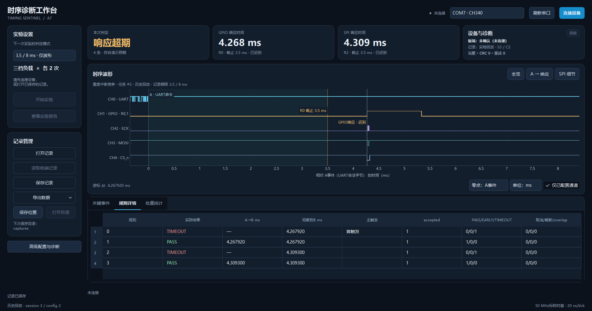

# FPGA跨协议时序诊断平台

Timing Sentinel A7 是基于 AMD Artix-7 的数字事件时序诊断样机。它在同一时间基准下监听 UART、GPIO 和 SPI，用可配置硬件规则判断“收到命令后，输出是否在规定期限内响应”，并保存可回放的原始波形、事件和规则配置。

## 直接下载运行

[下载 Windows x64 免安装版（约66 MB）](https://github.com/yangdaniu8-ui/timing-sentinel-a7/releases/download/v0.4.9-public-20261020/TimingSentinelA7-0.4.9-USR43-20261020-win64-portable.zip)

完整解压后双击`START.cmd`，或运行`app/TimingSentinelA7-SPI.exe`；无需安装Python或Vivado。请保留全部配套文件，不要只复制EXE。没有板子也能用随包历史记录回放体验。上方`Code → Download ZIP`是源码，不是免安装运行包。

[发布说明与校验文件](https://github.com/yangdaniu8-ui/timing-sentinel-a7/releases/tag/v0.4.9-public-20261020) · [本次版本检查](docs/releases.md)


## 先看这些

- [最新技术文档 PDF（14页，参考文献独立一页）](docs/technical_report.pdf)
- [可复用技能包与离线使用示例](skill/README.md)
- [大模型协作与真实纠错记录](report/llm_collaboration.md)
- [技能包提交要求对应表](docs/skill_submission.md)
- [丝印引脚接线说明](docs/wiring.md)
- [上位机使用说明](host/packaging/COMPACT_QUICK_START.md)
- [源码重建与测试](docs/build_and_validation.md)
- [测试条件与结果](docs/verification.md)

最新技术文档以本仓库PDF为准，新增独立一页说明技能提炼、题目外复用、验证与边界。此次补齐skill目录、真实协作记录及含Skill的新版源码RAR；程序与固件不变，不重打免安装ZIP。现有免安装ZIP仍内附早期报告，请另取最新版；旧源码RAR也不会自动更新。

## 核心功能

- 8位、65,536点数字波形缓存，四条可配置并行规则。
- UART指定字节作为A事件，GPIO指定边沿或SPI匹配字节作为B事件，输出PASS、EARLY或TIMEOUT。
- 迟到响应仍可记录实际到达时间；无响应不填成零延迟。
- STM32执行同一个FIR计算任务，用三档定时器中断负载展示响应时延变化。
- 单期限模式比较3.5 ms与8 ms；同事务模式用四规则同时检查同一个响应的两个期限。
- Windows上位机支持配置回读、关键事件定位、记录保存回放、统计报告及CSV/VCD导出。
- 正式板端支持原预设声光与按键演示；同事务四规则预设明确为“仅波形”。



上图是已保存实物任务3的历史回放，不是正在进行的采集。GPIO约4.268 ms、SPI约4.309 ms；四规则结果为TIMEOUT/PASS/TIMEOUT/PASS，反映同一个响应与3.5/8 ms期限的关系。

## 平台与目录

| 项目 | 当前组合 |
| --- | --- |
| FPGA板 | 正点原子ATK-DF7A35 V2.1，XC7A35T-2FGG484 |
| FPGA镜像 | USR43，USR_ACCESS 0x4D565043 |
| 任务板 | STM32F103C8T6，FIR计算与定时器中断竞争 |
| 上位机 | Python / PySide6 / pyqtgraph / pyserial，0.4.9 |
| 实物实验采样 | 5 MS/s，UART 115200 bit/s，SPI mode0 / 250 kHz |
| 时基 | 50 MHz标称时基，逻辑20 ns/tick；波形采样200 ns/点 |

`fpga/`为RTL、XDC、测试台、向量与Tcl；`mcu/`为C、启动、链接及本地检查器；`host/`为上位机及测试；`fixtures/`为历史测试输入；`reference_firmware/`为已验参考镜像。`skill/`为可复用校验脚本、工作流与示例，`report/`含技术正文及大模型协作记录；`references/`和`docs/`提供真实照片、模板与PDF。工具安装目录、厂商软件包、虚拟环境、构建缓存和个人Git历史不随仓库发布。

## 运行上位机

Windows x64，已验Python 3.13。建议建立独立虚拟环境，不覆盖全局环境：

```powershell
py -3.13 -m venv .venv
.venv/Scripts/python.exe -m pip install -r host/requirements-build.txt
pwsh -NoProfile -File scripts/run_host.ps1 -Python "$PWD/.venv/Scripts/python.exe"
```

连接时选择实际CH340串口；COM号随电脑变化，不选蓝牙口。已有板端冻结记录时先读、先存，不用RESET清除。正常展示不用JTAG或ST-Link。两板各自供电、只共地，不并联电源脚；输入仅接3.3 V数字信号。

## 说明与许可

本项目面向接口联调和教学实验，不是模拟示波器或频谱仪；READY用于实验夹具受控启动，上传期间有采集空档。测试结论按具体配置、记录和版本分别描述。

新编写的通用技能内容按`skill/LICENSE`的MIT许可供他人复用，该许可不改变工程其他自有代码与第三方组件的许可。其他源码公开用于作品展示与查阅，不自动追加全工程通用许可；第三方组件的原许可及归属见`third_party/`与`host/packaging/NOTICES.md`。厂商工具和头文件须自行合法取得。
