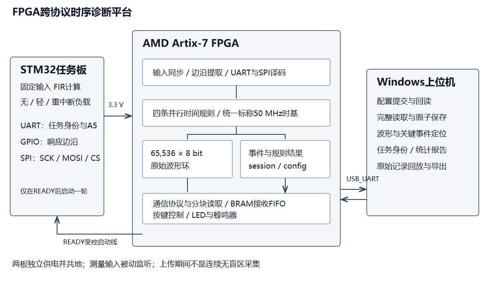
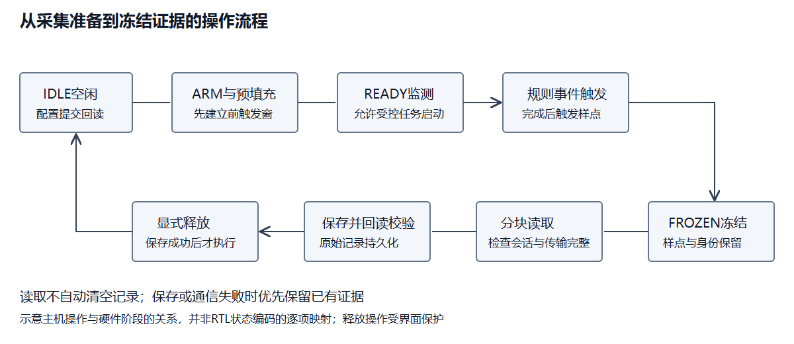
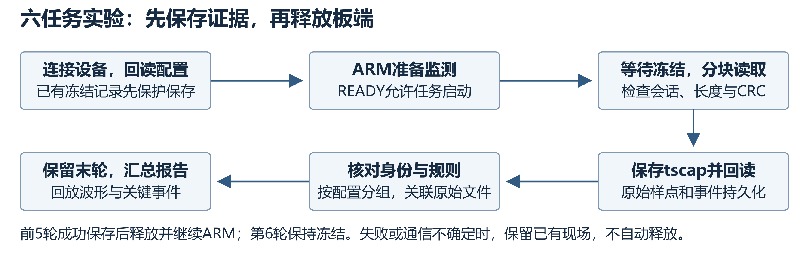
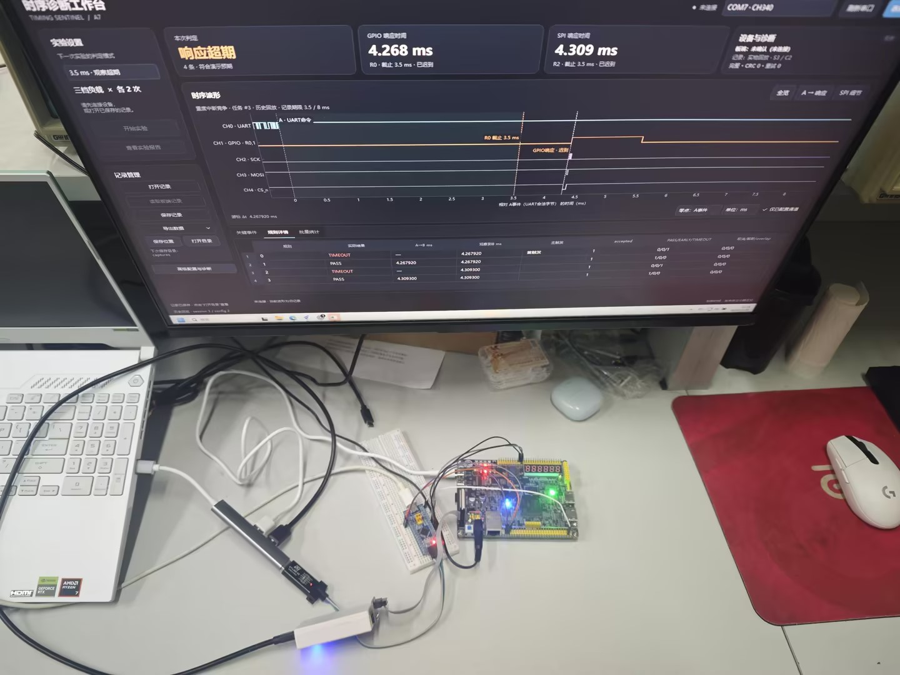
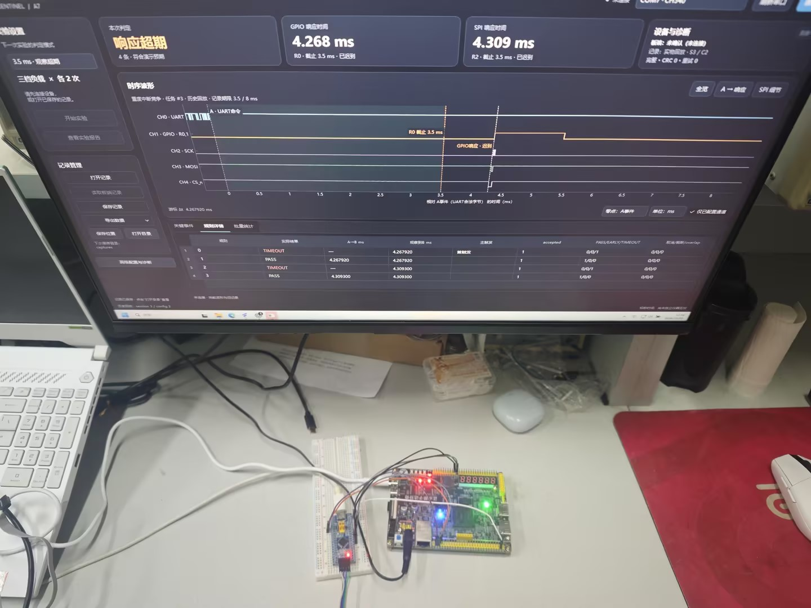
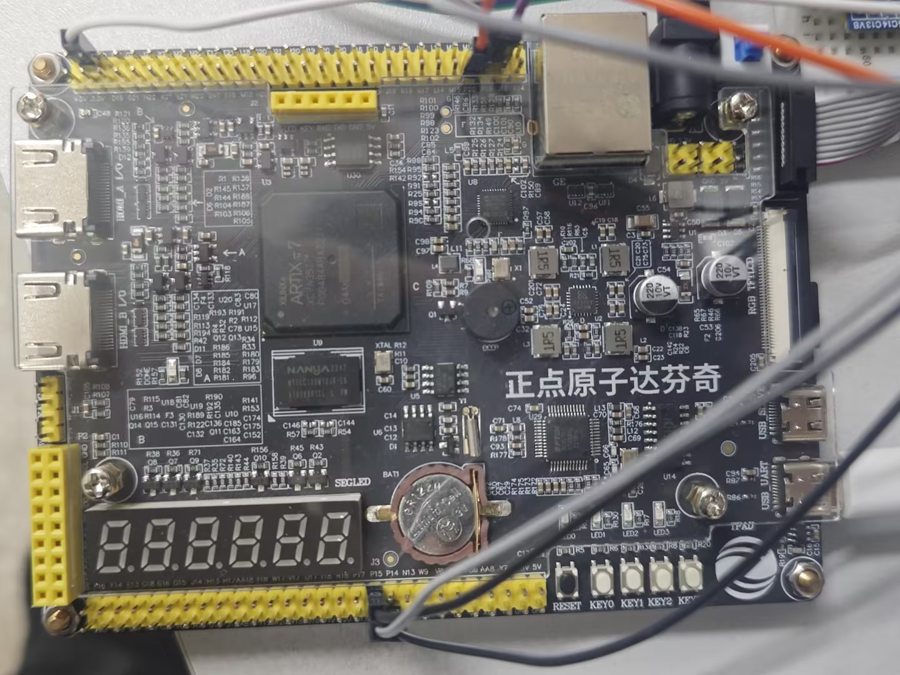
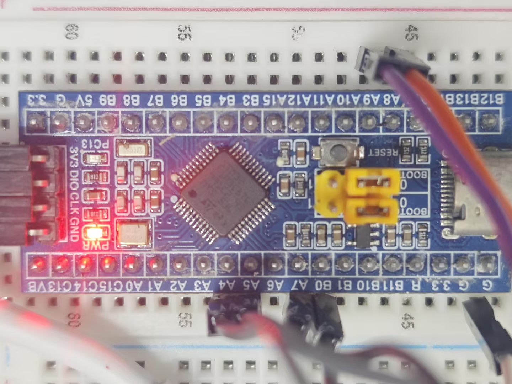
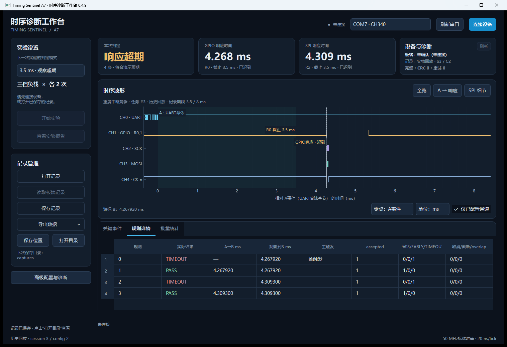
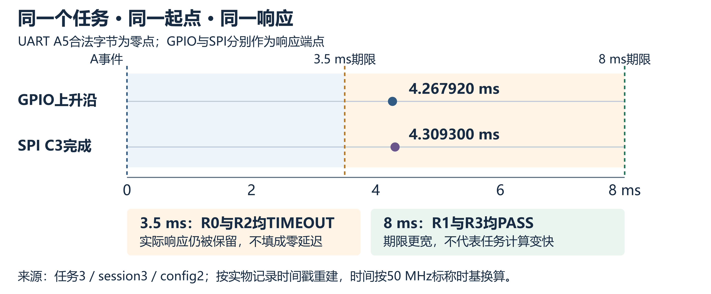
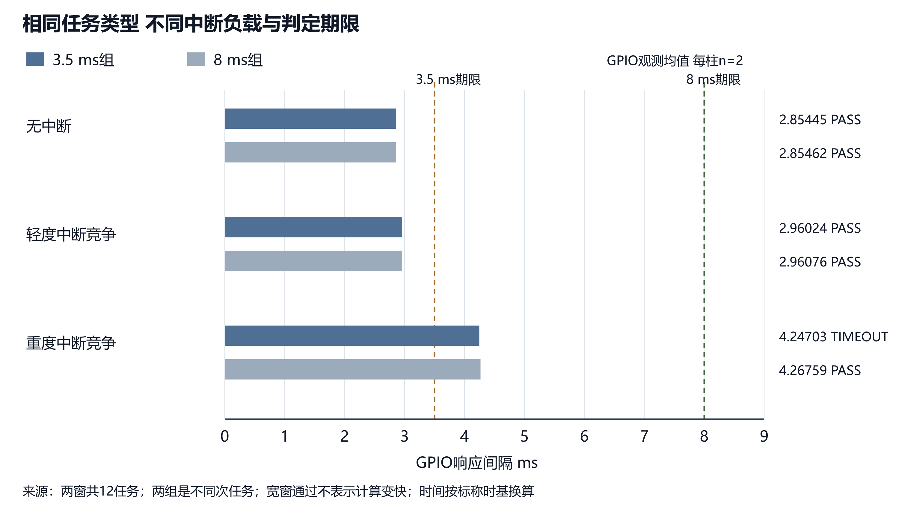

# FPGA跨协议时序诊断平台

## 摘要

接口联调时，看到信号发生变化还不够，还需要知道它是否在规定时间内发生。例如，UART命令发出后，GPIO完成信号有没有迟到，SPI结果字节是否按期到达。本作品针对这类问题，基于AMD Artix-7 FPGA设计了跨协议时序诊断平台。平台将接口事件之间的时间要求配置为四条并行硬件规则，给出正常、提前或超时判定，并保存相关波形、事件和配置，供后续查看。

系统由FPGA诊断板、STM32任务板和Windows上位机组成。STM32执行固定输入的真实FIR计算，通过三档定时器中断负载形成受控竞争。FPGA采用50 MHz标称时基，波形缓存为65,536点×8 bit，实验采样率为5 MS/s。在同事务实验中，一次任务的GPIO响应为4.267920 ms，SPI响应为4.309300 ms；四条规则同时得到3.5 ms期限超时、8 ms期限通过的结果，原始样点重判也支持这一判定。

我们还完成了另一台电脑上的双期限12任务实验、正式FPGA镜像的600个受控任务验证，以及临时ILA镜像的12任务内部事件对照。通过这些实验，平台不仅能够指出响应是否超期，还能保留当时的信号，帮助开发者进一步检查问题。作品主要用于嵌入式接口联调、实时响应诊断和教学实验。

## 第一部分 作品概述

### 功能与特性

平台被动监听3.3 V数字信号，以指定UART字节为A事件，以GPIO边沿或SPI字节为B事件，检查两者间隔是否落在设定时间窗内。四条规则可同时观察一笔事务，也可为同一响应设置不同期限。响应迟到后，平台仍保留实际到达时间及相关波形。上位机负责配置回读、波形查看、任务识别、记录回放和统计导出；板端支持Flash启动、按键及原单期限预设的声光提示。同事务四规则预设仅展示波形。

### 应用领域

在嵌入式设备联调中，可用平台检查UART命令到GPIO完成信号的响应时间，或检查命令到SPI结果字节的到达时间。对于需要满足实时要求的固件，也可在输入和算法不变的情况下增加中断负载，观察响应是否超期。教学中则可将判定与波形放在一起，解释期限、负载与实际响应的关系。本项目使用固定合成输入的STM32计算任务开展实验，当前应用形态为桌面数字时序诊断工具。

### 主要技术特点

事件发生时刻由FPGA记录，输入同步、协议译码、计时和四规则状态机在硬件内并行运行，不以Windows收到数据的时刻代替测量时刻。逻辑计数间隔为20 ns，实验波形采样间隔为200 ns，分别用于判定和波形留存。每份记录关联会话及配置身份，读取时检查长度、CRC和偏移；保存后还可从原始电平重新解码，核对硬件给出的结果。

### 主要性能指标

| 指标 | 实现或实测条件 |
| --- | --- |
| FPGA器件 | XC7A35T-2FGG484 |
| 逻辑时基 | 50 MHz标称，20 ns/tick |
| 波形缓存 | 65,536点×8 bit |
| 时间规则 | 4条独立状态，可并行判定 |
| 实物采样 | 5 MS/s，200 ns/点 |
| 实验接口 | UART 115200 bit/s；SPI mode0 / 250 kHz |

### 主要创新点

1. 将UART至GPIO/SPI的时间要求配置为四条并行硬件规则，在采集过程中直接判断响应是否符合期限。
2. 将判定、配置、事件和原始波形一起保存，使迟到响应与未出现响应能够分别检查，并支持离线重判。
3. 对同一个起点和实际响应同时使用两种期限，避免用不同次任务的变化解释期限差异。

### 设计流程

我们先明确UART和SPI的计时端点及规则边界，再实现协议监听、四规则和关联缓存。通过仿真与原始样点重判检查后，接入STM32真实计算和中断负载。随后优化选择器与BRAM通信FIFO，并依次开展受控重复任务、ILA对照、Flash启动和跨电脑功能检查。

## 第二部分 系统组成及功能说明

### 整体介绍

STM32执行被测任务并输出标记与响应，FPGA提取事件、按规则判断并冻结相关波形，PC端提交配置、读取记录和生成报告。硬件承担对时间敏感的处理，软件负责交互与查看。测量通道只监听数字总线；另设的READY线控制实验夹具何时启动，不驱动被测UART或SPI信号。

图1 系统结构与数据流

ILA等工具适合观察FPGA片内信号和设置调试触发。本平台面向外部接口的响应要求，使用者先指定A、B事件和期限，再查看判定及对应波形。我们将规则配置和记录管理作为主要操作入口，侧重联调中的使用流程，并非声称其他波形工具没有相关功能。

### 硬件系统介绍

#### 硬件整体介绍

诊断板选用ATK-DF7A35 V2.1，核心器件为Artix-7 XC7A35T[2]。我们使用Verilog实现输入同步、UART/SPI监听、四规则状态机、波形与事件缓存、串口控制和板端交互，波形及通信缓冲采用片内BRAM[3]。STM32F103C8T6运行独立任务固件。正式FPGA镜像为USR43，临时ILA观察逻辑只用于调试，不包含在该镜像中。

两板各自供电，通过六根信号线和一根共地线连接。为便于其他人重新接线，下表以板上丝印为主列出对应关系，导线颜色不作为引脚定义。

| STM32引脚 | FPGA丝印 | 排针编号 | 功能及方向 |
| --- | --- | --- | --- |
| A9 / PA9 | R17 | J2-3 | STM32至FPGA：CH0 UART TX |
| B0 / PB0 | N15 | J2-5 | STM32至FPGA：CH1 GPIO响应 |
| A8 / PA8 | P20 | J2-8 | FPGA至STM32：READY |
| A5 / PA5 | R16 | J3-35 | STM32至FPGA：CH2 SPI SCK |
| A7 / PA7 | P15 | J3-36 | STM32至FPGA：CH3 SPI MOSI |
| A4 / PA4 | R14 | J3-37 | STM32至FPGA：CH4低有效CS |
| G / GND | GND | J2-53或J2-55 | 两板共地 |

接口只接3.3 V数字信号，两板电源不可并联，也不可接入5 V或RS-232电平。本实验不使用MISO。J3对应信号与LCD复用，当前接线下不同时插入LCD。

#### 机械设计介绍

样机采用开发板支撑和面包板进行桌面装配，主要考虑固定板卡、减少插接松动，并为按键、USB及供电接口留出操作空间。作品不涉及运动机构，实物照片见第三部分。

#### 电路各模块介绍

**输入与事件识别。** 外部信号先经同步，再提取边沿或译码字节。UART的A事件取停止位中心校验通过后的字节有效事件；SPI的B事件取低有效CS期间第8个采样沿完成的匹配字节。本实验使用SPI mode0、MSB优先。明确这些端点后，UART起始位、字节有效时刻和SPI片选结束就不会混入同一个计时定义。

**四规则并行状态机。** 每条规则分别配置UART匹配值及掩码、B事件、最小和最大间隔以及动作。一个A事件可以同时启动四条规则。令n为B与A的逻辑tick差，允许区间为[n_min, n_max]，时间换算为Δt = n × 20 ns。各边界条件的处理如下。

| 条件 | 硬件结果 | 处理含义 |
| --- | --- | --- |
| 首个匹配B满足n < n_min | EARLY | 响应提前，不被随后另一B改写 |
| 首个匹配B位于闭区间 | PASS | 响应在允许期限内 |
| 等待至n_max + 1仍无匹配 | TIMEOUT | 已超期，后续实际响应仍可作为证据记录 |

一条规则等待期间若再次收到A，新事件计入overlap，已有事务继续保留。在同事务预设中，R0/R1观察同一GPIO边沿，R2/R3观察同一SPI C3字节，每对分别采用3.5 ms和8 ms期限。

**波形与事件缓存。** 环形BRAM保留触发前后共65,536点波形，同时存放译码、边沿和规则事件。逻辑判定时间、采样锚点及首样点时间分别记录，以便回放时对齐。实验采样率为5 MS/s；同事务预设保留前23,000点、后42,535点，另含触发点，能够覆盖任务身份标记和8 ms期限。手动停止、记录截断及事件覆盖分别标记，避免将不完整记录当成正常结果。

图2 配置、捕获、保存与释放流程

**通信、声光与按键。** USB_UART用于提交配置、查询状态和分块读取，2048字节接收FIFO映射到BRAM。原单期限预设通过时提示一声，异常时提示三声，KEY3用于消音。同事务四规则预设为“仅波形”，不启用判定声光。KEY0可脱机启动，KEY1按记录来源和身份决定是否允许释放，普通按键不能覆盖电脑发起的冻结记录。按键默认2 ms期限，与GUI的3.5/8 ms预设分别使用。

FPGA配置镜像和STM32固件分别写入各自Flash，正常上电即可运行。波形仍保存在易失的BRAM中，因此需要在断电前上传保存，不能将固件的掉电保持与采集记录的保存混为一谈。

### 软件系统介绍

#### 软件整体介绍

Windows上位机采用Python、PySide6、pyqtgraph和pyserial，提供免安装运行包。主界面展示判定、GPIO/SPI响应时间、设备状态和波形，高级入口保留完整规则、元数据与日志。连接、板端记录和本地保存状态分别显示，当前记录与下次实验设置也分开管理，减少操作误解。

#### 软件各模块介绍

**设备与任务调度。** 串口操作由单个任务互斥执行，配置提交后必须回读一致。六任务实验开始前，程序先保存已有冻结记录，再提交预设、ARM、等待冻结、读取并保存。前五轮保存成功后释放板端缓存，末轮保留，六轮覆盖三档负载各两次。对于同事务报告，程序还检查四条规则的A是否相同，以及每对规则的实际B是否相同，满足条件才进行配对比较。

图3 六任务实验及证据文件生成

**记录、重判与统计。** tscap文件封装配置、样点和事件，通过成员长度、SHA256及会话身份检查完整性，临时文件核验后再原子保存。分析模块从原始电平重新解码A事件、GPIO和SPI，与硬件结果核对。负载身份取自E2任务标记并与样点匹配，而不是由PASS或TIMEOUT推测。HTML报告保留原始文件关联，按配置分组并去重；迟到时显示实际响应时间，未出现响应时显示缺失，不以0代替。

**STM32真实任务。** STM32对固定64点输入执行8抽头定点FIR三遍，核对累计结果后才输出GPIO与SPI C3。三档负载仅改变定时器中断条件：关闭中断、标称1000 μs周期和标称125 μs周期，输入和算法相同。响应由计算完成驱动，不以固定延时模拟。A至GPIO间隔还包含任务入口、校验及中断处理，应理解为任务响应时间，而非纯FIR执行时间。

FPGA、MCU和上位机分别提供源码与重建脚本，记录和构建文件通过哈希关联。当前公开上位机为0.4.9，正式FPGA镜像为USR43；临时ILA镜像单独归档，避免将不同版本的结果混用。

## 第三部分 完成情况及性能参数

### 整体介绍

样机已能完成真实任务响应的产生、FPGA期限判定，以及上位机的波形查看和保存。下列照片展示两板装配和任务3的历史回放界面。照片中的回放用于说明功能，不计入新增采集次数。

<!-- photo-pair -->

图4 系统正面全貌

图5 系统斜视全貌

### 工程成果

#### 机械成果

完成两板的桌面固定、接线与外接接口整理，保留按键和接口的操作空间。当前采用开发板装配，没有另设运动机构。

#### 电路成果

硬件部分完成了引脚约束、协议监听、四规则状态机和缓存逻辑，并接入声光、按键及Flash启动。我们使用现成开发板完成样机，自研内容主要是FPGA诊断逻辑和STM32任务固件，而非开发板本身。

<!-- photo-pair -->

图6 FPGA诊断板

图7 STM32任务板及接线

#### 软件成果

上位机已提供免安装程序、记录回放、报告和CSV/VCD导出。图8展示已发布EXE打开任务3历史记录的画面，使用者可在同一界面查看判定、实际响应和配置；下文给出对应的精确数值。记录也可在未连接板卡时重新打开。

图8 免安装上位机的同事务四规则历史回放

### 特性成果

#### 核心实验：同一响应在两个期限下如何判定

我们保持两板固件不变，采集三档负载各两次，共六个任务。每次启用四条规则，得到393,216样点和24条规则结果。四规则共享同一UART A5，R0/R1对应同一GPIO上升沿，R2/R3对应同一SPI C3字节；再从原始样点重新解码，核对起点、配对响应和判定。

以任务3为例，GPIO在4.267920 ms到达，晚于3.5 ms而早于8 ms；SPI在4.309300 ms完成，也落在这两个期限之间。四条规则因此给出以下结果。

| 规则 | 响应事件 | 期限 ms | 实际响应 ms | 判定 |
| --- | --- | --- | --- | --- |
| R0 | GPIO上升沿 | 3.5 | 4.267920 | TIMEOUT |
| R1 | 同一GPIO上升沿 | 8 | 4.267920 | PASS |
| R2 | SPI C3字节 | 3.5 | 4.309300 | TIMEOUT |
| R3 | 同一SPI C3字节 | 8 | 4.309300 | PASS |

图9 任务3的同一响应与3.5/8 ms期限关系，按记录时间戳重建

两次重负载均得到TIMEOUT/PASS/TIMEOUT/PASS，其余四次全部通过，新增通信CRC错误和重试为零。同一响应对严格期限超时、对宽松期限通过，并不表示任务变快；四条规则同时工作，也避免了不同次任务波动带来的影响。原始记录`round_03_s3.tscap`随源码提供，可重新解码复核[6]。

该任务的SPI比GPIO晚41.380 μs。程序先置位GPIO，再建立片选并发送SPI字节。8位、250 kHz的移位时间为32 μs，加上片选建立和软件开销，可以解释上述间隔；两种响应并非两次FIR计算。

#### 负载实验：同一计算任务为何出现超期

我们在另一台Windows电脑开展了两组单期限实验，每组均为无中断、轻度竞争和重度竞争各两次。12份记录共786,432样点、24条启用规则。两组属于不同次任务，分别统计；下表每格为两次测量的均值（n = 2），单位ms，按GPIO / SPI排列。

| 中断负载 | 3.5 ms组均值 | 8 ms组均值 | 两组判定 |
| --- | --- | --- | --- |
| 无中断 | 2.85445 / 2.89521 | 2.85462 / 2.89599 | 通过 / 通过 |
| 轻度竞争 | 2.96024 / 3.00100 | 2.96076 / 3.00152 | 通过 / 通过 |
| 重度竞争 | 4.24703 / 4.28841 | 4.26759 / 4.30898 | 超时 / 通过 |

图10 三档负载的GPIO响应均值，每组每档两次独立任务

输入和算法保持不变时，GPIO响应由无中断的约2.85 ms增加到重负载的约4.25 ms。3.5 ms期限能揭示这里的超期现象，8 ms则给出宽窗对照。两组结果与同事务实验相互补充：前者展示负载变化，后者排除任务间波动后比较期限。本组每档两次，适合展示受控条件下的现象，尚不足以推断尾延迟或故障率。

另机实验还检查了保存、重连读取同一记录和关闭重开后的回放，样点重判与统计相符，新增CRC错误和重试为零。最终公开运行包的启动、回放、重开、接板读取及保存记录重开，也由操作人员另行确认正常；这项使用确认不重复计入上述12任务。

#### FPGA实现、资源优化与验证

下表列出正式USR43的实现结果。临时ILA镜像增加了调试逻辑，其资源占用不计入这张表。

| 项目 | 正式实现结果 |
| --- | --- |
| LUT | 7609 / 20800，36.58% |
| FF | 7833 / 41600，18.83% |
| BRAM 36 Kb等效块 | 22 / 50，44.00% |
| DSP | 0 |
| 50 MHz约束下时序 | WNS 3.346 ns；WHS 0.055 ns |
| 默认DRC检查 | 0项违规 |

我们将2048字节接收FIFO从逻辑存储迁移至BRAM，较上一候选净减少449个LUT，增加45个FF和0.5块BRAM等效资源，接口及容量未变。验证重点是空满边界、读写时序和背压处理仍符合原有行为。表中正时序裕量对应已约束路径。

| 验证层次 | 范围 | 已取得结果 |
| --- | --- | --- |
| 正式FPGA重复任务 | 600个READY受控任务，六种组合各100次 | 39,321,600样点、1200条规则重判；约89.99分钟，新增CRC/重试为零 |
| ILA内部对照 | 临时调试镜像，三档负载×两期限共12任务 | 12,288行tick限定数据、256条A后事件与外部采样记录对应 |
| 软件交付 | 当前源码435项测试，新EXE离线自测及新路径解压运行 | 保存、回放、导出与报告检查通过；最终运行包另机最小复验由操作人员确认正常 |
| 上电和操作 | 正式镜像Flash读回、真正断电后按键及记录核验 | 固件上电启动，原单期限预设声光正常；KEY3消音通过 |

600任务使用正式镜像，以直接协议流程检查受控重复任务；ILA实验使用临时镜像观察内部事件。ILA[4]采用5个物理探针、1024深度，间隔按48位tick解释，相邻事件行不等于相邻时钟拍。两类数据分版本保留，不重复计作新上位机实物测试；正式Flash仍使用不含ILA的USR43。

#### 适用条件

本报告的实物条件为3.3 V、CH0至CH4接入、5 MS/s、UART监听115200 bit/s，以及SPI mode0 / 250 kHz。时间按50 MHz标称时基换算，20 ns/tick用于逻辑计数，200 ns/点用于本次波形采样。3.5 ms和8 ms用于演示期限差异，并非某类设备的通用合格标准。

实验通过READY控制任务，上传和重新准备期间有采集空档，因此当前结论针对受控采集，不是自由运行的连续无盲区记录。原单期限预设有声光，同事务四规则预设仅展示波形。使用时需要在断电前保存冻结记录；接入CH5至CH7或改变速率后，应补充对应验证。

## 第四部分 总结

### 可扩展之处

后续首先考虑输入保护、接口防误插，以及串口识别、连接提示和故障恢复步骤，让样机更便于交给其他人使用。扩展通道、采样率和传输速度时，需要保留现有的事件定义、配置身份与完整性检查，再补充对应实物测试。更大缓存、数据压缩和新协议也有扩展空间，但不影响当前版本的使用。

### 心得体会

这个项目让我们更具体地理解了“看见波形”和“判断响应是否及时”之间的区别。UART字节和SPI字节各有明确的完成时刻，如果计时端点没有先说明，图上相似的距离也可能代表不同含义。因此，我们先定义A、B事件和允许时间窗，再围绕这些定义组织规则、缓存和显示。

另一个体会是，超时之后的信号同样值得保留。响应虽然错过期限，仍可能在稍后到达。只显示一个TIMEOUT，无法分辨迟到、没有响应或记录不完整。将原始样点、配置和事件一起保存，再提供回放，使这些情况能够继续检查。先保存再释放、区分当前记录与下次设置，也是在联调过程中逐步明确的操作要求。

资源优化则提醒我们，表中的数字只是设计取舍的一部分。FIFO迁移到BRAM后确实减少了LUT，但仍需重新检查读写、空满和握手行为。仿真、ILA、受控任务和软件回放分别覆盖不同环节，不能用其中一项替代其他检查。遇到失败时保留候选版本和原始记录，比只留下最终的“通过”更有助于定位问题。

目前，样机已能在真实计算任务上完成跨接口期限判定，并把结果对应到可查看的波形。我们的收获是，诊断工具既要说明是否满足要求，也应保留信号实际发生的过程，让后续分析有据可查。

### 大模型协作与可复用技能包

在本项目的开发中，我们将大模型用于设计讨论、代码检查、测试用例整理和文档梳理，以减少重复工作，把更多精力放在事件定义、接口时序和验证结果的判断上。我们负责确定需求与设计取舍，模型提出的方案则通过仿真、实现检查和实物记录逐项验证。对于涉及烧录、数据释放等可能影响实验现场的操作，我们先确认状态和记录是否保存，再决定如何执行。

实际开发让我们认识到，模型给出的“通过”需要有明确的依据和范围。例如，仿真通过的候选设计仍可能在实现阶段被DRC拒绝；串口读取失败时，板端也可能仍保存着完整数据。在整理提交材料时，我们还发现，文件清单匹配并不意味着材料已经齐备。因此，我们把文件完整性、结果一致性、板级运行和提交内容分别检查，并用实际日志纠正过早作出的判断，而不是仅依赖模型的文字结论。

基于这些经验，我们将重复使用的检查步骤整理为“验证证据与交付一致性”技能包。它既提供可直接执行的Python脚本，也说明如何向大模型提供输入、解释结果和处理失败。使用者先选定需要交付的文件，以长度和SHA256建立清单；接收后检查文件是否缺失或改变，再将实际输出与参考结果按标识逐项比对。遇到缺项、重复标识或非法数值时，工具会明确报错，不以零值补齐，也不修改输入来获得“通过”。

为了检验这套方法能否脱离本项目使用，我们准备了计数器和FIR滤波器两组合成数据，验证正确结果能够通过、注入的错值能够被识别；随后仅复制脚本和示例到新目录，在隔离环境中重复执行。34项脚本测试中33项通过，另1项因Windows权限限制无法创建真实符号链接而跳过，相关拒绝分支另以模拟测试覆盖。这些结果验证的是离线检查与迁移使用能力，不代表其他板卡已经完成实物验证。

该技能不依赖本项目的板卡、引脚或通信协议，其他开发者可用它比对计数器、滤波器和接口桥的参考输出，也可用于MCU、FPGA与PC联合项目的版本交接。迁移时需要明确新的输入格式、单位、参考结果和容差依据；文件哈希只能说明内容是否一致，不能代替算法、时序或硬件验证。我们以MIT许可公开该技能，入口为`skill/README.md`，示例、验证结果及真实大模型交互记录随源码提供，便于查阅和复现。我们希望沉淀下来的不仅是本作品的操作步骤，也是一套其他项目能够直接采用、并能清楚说明判断依据的检查方法。

## 第五部分 参考文献

[1] AMD. 全国大学生嵌入式芯片与系统设计竞赛2026 FPGA赛道选题指南 AMD[Z]. 2026.

[2] 正点原子. 达芬奇FPGA开发板ATK-DF7A35 V2.1原理图与布局图[Z].

[3] AMD. 7 Series FPGAs Memory Resources User Guide: UG473[EB/OL]. https://docs.amd.com/v/u/en-US/ug473_7Series_Memory_Resources.

[4] AMD. Vivado Design Suite User Guide: Programming and Debugging, UG908[EB/OL]. https://docs.amd.com/r/en-US/ug908-vivado-programming-debugging/ILA.

[5] STM32F103C8T6开发板原理图[Z].

[6] 项目实验归档. 同事务四规则、双期限中断负载、USR43重复任务及ILA配对记录[DS]. 2026.
