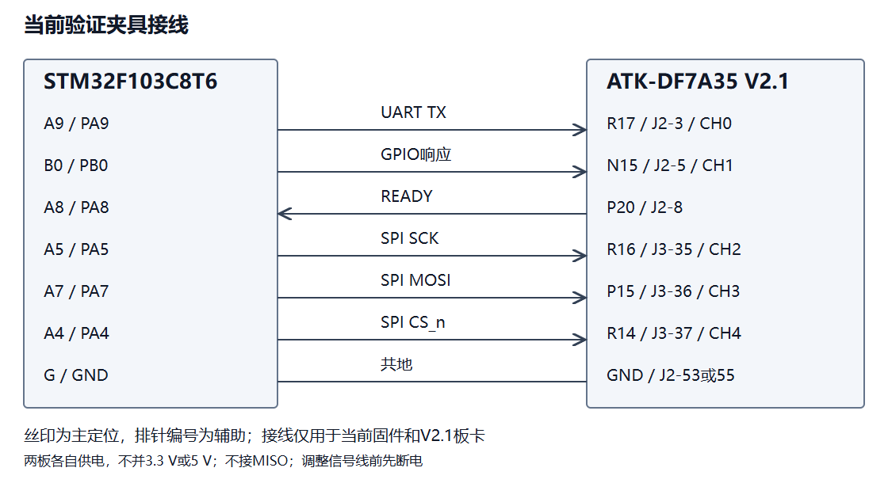
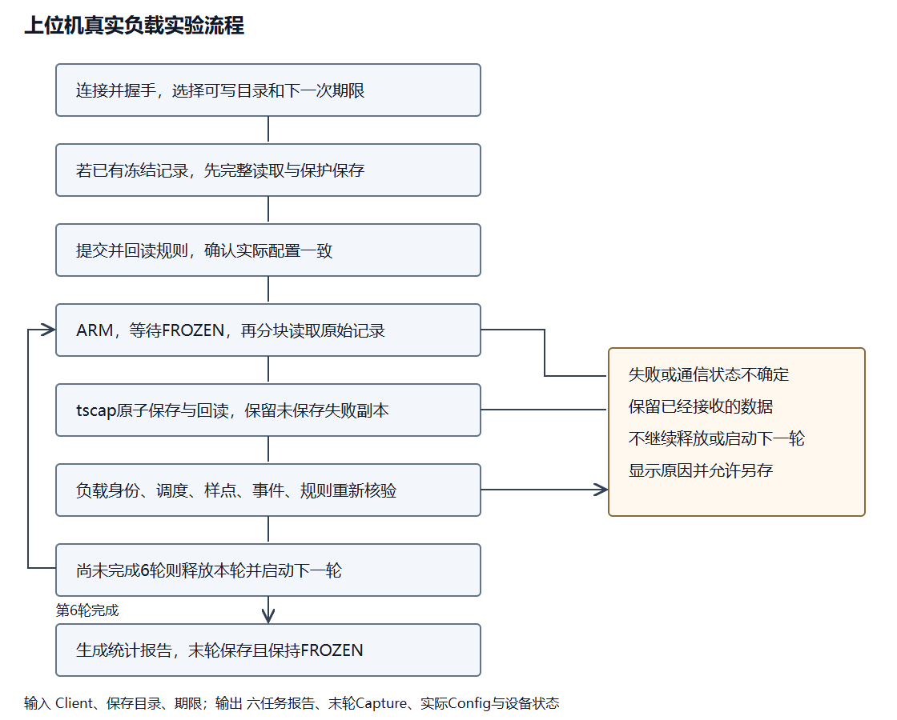
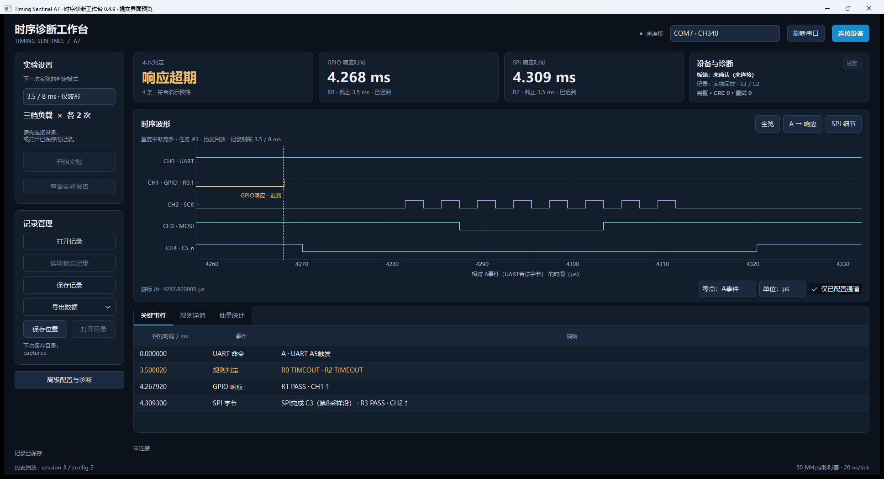
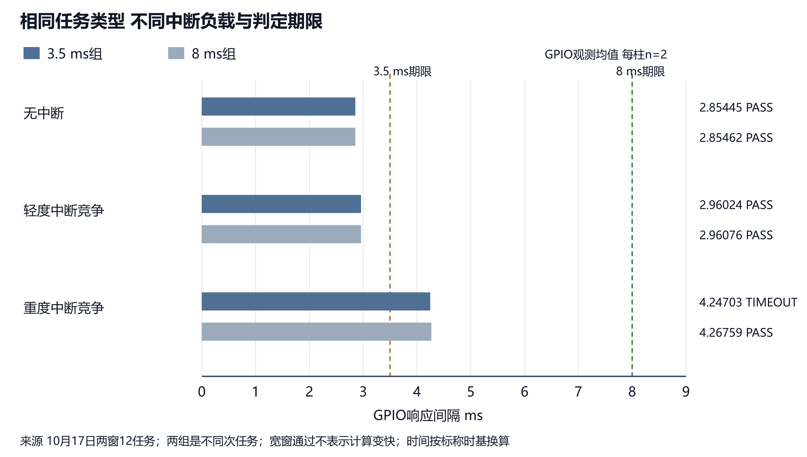
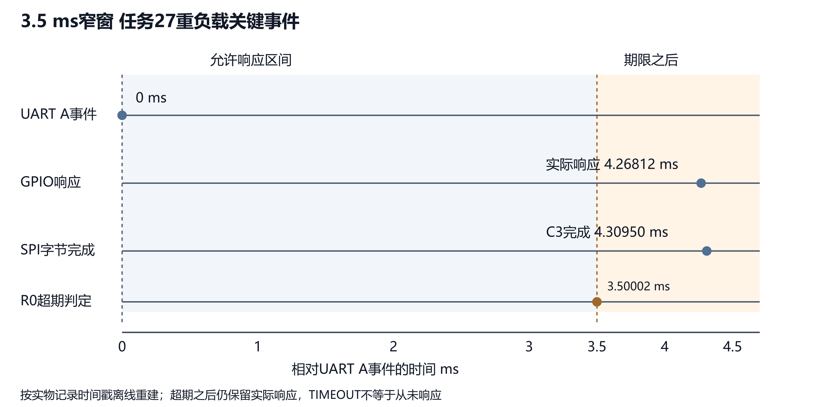

# FPGA跨协议时序诊断平台

## 摘要

嵌入式设备的调试不仅需要观察单条数字波形，还需要回答“某个接口事件发生后，另一个接口是否在规定时间内响应”。本作品基于AMD Artix-7 FPGA实现跨协议时序诊断，将UART指定字节与GPIO边沿或SPI匹配字节关联，通过四条并行规则执行可配置时间窗判定，并保留原始样点、事件日志和配置身份，使异常结果能够被回放与复核。

系统由ATK-DF7A35 V2.1开发板、STM32F103C8T6任务板及Windows上位机组成。FPGA采用标称50 MHz逻辑时基，具有65,536点、8位宽波形缓存；当前实验使用5 MS/s波形采样。STM32对固定合成输入执行实际FIR计算，通过不同强度的定时器中断形成受控竞争。上位机支持配置回读、任务负载识别、自动采集保存、波形定位和统计报告。

在另一台Windows电脑上完成的两组实验中，3.5 ms和8 ms期限各执行六任务，每档负载各两次，共获得786,432样点和24条启用规则结果。窄窗下无中断与轻负载通过、重负载超期；宽窗下三档均通过，原始波形重判与硬件结果一致，通信CRC错误和重试均为零。后续同事务四规则实验又取得六份记录，同一重载响应同时被3.5 ms规则判为超时、8 ms规则判为通过，避免把不同次任务当作同一响应进行比较。作品的工程特点是将跨协议时间约束的硬件判定与可追溯波形证据结合。时间按50 MHz标称时基换算，逻辑计数间隔为20 ns。

## 第一部分 作品概述

### 功能与特性

平台对3.3 V UART、GPIO及SPI数字信号进行被动监听，以UART字节事件为起点，以指定GPIO边沿或SPI匹配字节为响应，执行正常、提前和超时判定。四条规则分别保存事务状态与计数，异常判定后仍可保留迟到响应。原始波形、事件和配置身份共同封装为记录文件，支持离线回放与重新解码。上位机提供三档真实负载实验、单期限及同事务双期限对照、报告与CSV/VCD导出。板端提供按键启动、记录保护及原预设声光提示；新增四规则预设仅展示波形，不启用判定声光。固件已写入Flash，日常无需重新下载，冻结波形仍须在断电前保存。

### 应用领域

适用于嵌入式设备接口联调、串行事件至执行输出的期限检查、固件响应性能比较及数字系统教学。开发者可以将“收到指定UART字节后，GPIO是否及时翻转”或“结果标记是否通过SPI及时出现”写成明确规则，在多个接口之间建立统一观察口径。本作品用于数字事件时序诊断，不测量模拟幅度或频谱，不提供安全关键系统的硬实时认证。当前STM32合成输入实验是验证夹具，不等同于已经部署在车辆、工业执行机构或真实传感器系统中。

### 主要技术特点

输入同步、串行协议译码、时间约束判断与波形采样在FPGA中协作完成；规则计时与波形采样率分离，避免将显示采样间隔当成规则计数分辨率。每轮记录绑定session和config身份，分块读取时检查身份、长度及CRC，保存采用完整性校验和原子发布。上位机将任务身份、实际规则判定与演示预期分开显示，明确历史回放、数据不完整和未保存状态。受控激励通过READY握手启动，在记录保存后才释放缓存；因此可重复复核，但上传期间存在采集空档。

### 主要性能指标

| 指标 | 当前实现或实测条件 |
| --- | --- |
| FPGA | XC7A35T-2FGG484 |
| 逻辑时基 | 标称50 MHz，20 ns/tick |
| 数字波形缓存 | 65,536点×8 bit |
| 并行规则 | 4条；同事务实验全部启用 |
| 本轮波形采样 | 5 MS/s，200 ns/点 |
| 控制串口 | 115200 bit/s，8N1 |
| 本轮SPI | mode0，250 kHz，8位，MSB优先 |
| 验收记录 | 另机双窗12次，同事务6次 |

### 主要创新点

1. 将UART字节与GPIO或SPI响应关联为可配置时间约束，由四条硬件规则并行判定，减少跨接口人工找点和对时操作。
2. 将判定结果、配置身份、原始波形及事件联合保存，超期后仍保留实际响应，支持重新解码与追溯。
3. 以真实计算和中断竞争构成可重复实验，并用两种期限区分“任务响应变慢”和“允许期限改变”。

### 设计流程

首先固定UART和SPI事件计时口径，完成点灯、串口和单规则回环；随后扩展为四规则、外部SPI监听及环形捕获。通过边界仿真、原始样点重判与实物任务实验检验行为，再优化配置及回复选择器、将2048字节接收FIFO迁移到BRAM。最后完成实体按键、声光提示、重复任务、Flash读回、断电启动、ILA对照和另一台电脑上的采集回放验证。

## 第二部分 系统组成及功能说明

### 整体介绍

系统分为被测任务、FPGA诊断和PC交互三个部分。STM32执行任务并输出UART标记、GPIO响应及SPI字节。FPGA通过同步后的数字输入取得事件，在统一计数基准上执行规则，保存触发前后的波形，并经板载USB_UART与PC通信。上位机负责配置、显示及持久化，不使用Windows线程调度时间充当板端事件时间戳。

图1 系统整体结构

测量输入为被动监听。另有一根FPGA至STM32的READY线，用于验证夹具的受控启动，不用于驱动被测UART或SPI总线。日常电脑连接的是USB_UART；JTAG和ST-Link仅在配置、恢复或诊断时使用。两板独立供电并共地，不并联3.3 V或5 V电源。

### 硬件系统介绍

#### 硬件整体介绍

FPGA开发板为ATK-DF7A35 V2.1，目标器件为XC7A35T-2FGG484。正式镜像标识为USR43，对应USR_ACCESS值0x4D565043。核心逻辑采用Verilog实现，不依赖板上ARM处理系统或PYNQ。板载BRAM承载波形、事件及通信缓冲，当前功能没有使用DDR3缓存或FT232H高速传输。

STM32F103C8T6最小系统板运行独立任务固件。两板间使用六根信号线和一根共地线。接线以板上丝印为主要定位，排针编号作为辅助，避免使用杜邦线颜色作为定义。

| STM32引脚 | FPGA板上丝印 | 排针编号 | 功能及方向 |
| --- | --- | --- | --- |
| A9 / PA9 | R17 | J2-3 | STM32至FPGA，CH0 UART TX |
| B0 / PB0 | N15 | J2-5 | STM32至FPGA，CH1 GPIO响应 |
| A8 / PA8 | P20 | J2-8 | FPGA至STM32，READY |
| A5 / PA5 | R16 | J3-35 | STM32至FPGA，CH2 SPI SCK |
| A7 / PA7 | P15 | J3-36 | STM32至FPGA，CH3 SPI MOSI |
| A4 / PA4 | R14 | J3-37 | STM32至FPGA，CH4低有效CS |
| G / GND | GND | J2-53或J2-55 | 两板共地 |

图2 测试夹具信号连接关系

输入接口只接3.3 V数字信号，不直接连接5 V或RS-232电平。本测试不接SPI MISO、STM32 PA10或模拟传感器。J3信号与LCD复用，本配置不同时插入LCD。测试样机使用通用开发板与杜邦线，面向桌面接口调试；连接前应检查电平、共地与插接方向。

#### 机械设计介绍

作品为桌面式电子诊断样机，没有自制运动机构、机械执行器或外壳结构。实现重点是数字时序监测与证据保存，因此未设计机械传动。展示时将两块板平放固定，保持导线短、插接可靠，留出USB和电源接口操作空间。后续若制作外壳，应先保证输入电平保护、散热和接口防误插，而不是仅增加外观结构。

#### 电路各模块介绍

**输入同步与协议监测。** `input_frontend`对外部数字输入进行同步并提取边沿；`target_uart_monitor`按8N1口径检查合法字节，帧错误不作为规则起点。UART A事件定义为停止位中心校验通过，不能与起始位或笼统的整帧末端混用。`target_spi_monitor`在低有效CS内采集SPI字节，本轮使用mode0、MSB优先；匹配SPI响应的时间点是第8个采样沿，不是CS抬高时刻。

**四规则时间约束。** 每条规则包含UART匹配值/掩码、目标事件、最小与最大间隔和动作设置。一个UART事件可同时启动多条启用规则。首个匹配响应早于最小间隔时判EARLY，位于闭区间内判PASS；到最大间隔仍未匹配，则在下一逻辑拍判TIMEOUT。提前响应不会因随后出现另一响应而改写成PASS。忙时新起点单独记录overlap，不覆盖正在等待的事务。

原单期限实验中，R0监听CH1上升沿，R2监听SPI字节0xC3，二者共享UART 0xA5起点，启用掩码为0x05，R1/R3禁用，每个任务产生两条结果。新增同事务实验使用掩码0x0F：R0/R1检查同一个GPIO响应的3.5/8 ms期限，R2/R3检查同一个SPI响应的3.5/8 ms期限，四条规则共享同一UART起点。两类实验分别核算，不把原两规则记录追认为四规则测试。

**波形与事件缓存。** 65,536点×8 bit波形环形缓存保存同步后的数字电平，事件缓存保存译码、边沿和规则结果。记录同时保留逻辑判定时间、采样锚点和首样点时间；显示采用原始时间戳推导，而不是把两种时间强行对齐。采样使用分频10，即5 MS/s；单期限预设前触发45,000点、后触发20,535点，另含触发点。同事务预设改为前23,000点、后42,535点，分别为4.6/8.507 ms，兼顾3.5 ms超时前的完整身份标记和最早触发后完整8 ms期限。两者总点数均为65,536。事件覆盖、手停和截断均显式记录，不能用“未收到事件”推断“事件没有发生”。

图3 采集与冻结记录保护流程

**通信与声光模块。** 控制协议通过USB_UART提供同步、身份查询、配置、ARM、状态、读取及释放操作。2048字节接收FIFO映射到BRAM，减少逻辑实现的缓存开销。原单期限任务预设支持响应/判定LED及通过一声、异常三声，KEY3可消音。正式固件按已验证配置限定声光资格，新增同事务四规则预设不在白名单内，不启用判定声光；界面明确标为“仅波形”，没有为该展示修改固件。KEY0与KEY1提供脱机启动和受保护释放；电脑发起的冻结记录不会被板上普通按键直接覆盖。按键默认2 ms规则与GUI单期限3.5/8 ms不同，演示时不能混用。

**固件与波形保存的区别。** FPGA配置镜像写入16 MiB配置Flash，STM32程序保存在内部Flash。固件掉电后可在重新上电时启动，但BRAM中的冻结记录是易失数据，必须先上传保存。Flash最终写入使用整片清空、全片空白读回、写入及再次全片读回流程；这些操作属于维护步骤，不在上位机日常连接时自动执行。

### 软件系统介绍

#### 软件整体介绍

上位机使用Python、PySide6、pyqtgraph和pyserial，实现Windows图形界面，并打包为免安装EXE。界面默认突出本次判定、GPIO与SPI观测时间、设备与传输状态、波形和关键事件；完整配置、原始元数据及通信日志收在高级入口。连接状态、板端冻结状态与本地是否保存分别显示，避免把“串口已打开”“记录已冻结”和“文件已保存”混为一谈。

系统组合为上位机0.4.9、FPGA USR43及STM32 FIR/IRQ固件，构建记录采用release_id和文件哈希关联源码、运行程序及参考镜像，避免同一版本号下混入不同开发产物。

上位机完成435项离线检查，交付源码的路径迁移也经过同数量测试。免安装程序通过离线自测、新路径解压运行、实际板端冻结记录读取/保存/重连及四规则历史回放；随包源码与对应运行版本逐文件核对。另一台电脑的12任务采用前一免安装版本，FPGA和STM32测量固件保持相同，测试结果按各自版本和记录编号归档。

#### 软件各模块介绍

**交互与后台任务模块。** `MainWindow`处理用户动作，串口读取、报告计算和导出由工作任务执行。前台采用单任务互斥，连接、断开、配置、读数不并发使用同一串口。后台状态观察不反复切换整个界面的忙碌外观，用户动作需在状态确认后执行，避免连接按钮和布局随轮询抖动。

**设备客户端模块。** `Client`输入串口字节流和操作参数，输出身份、已回读配置及采集记录。协议对请求号、CRC、响应长度和session/config进行检查。读取分块携带身份与偏移，重复读取不推进隐藏游标；通信不确定时不继续释放或发起下一事务。配置必须提交并回读一致，不能只修改本地下拉框就认为板端规则已改变。

**真实负载实验模块。** `workload_batch`取得下一次期限和保存目录，调用`run_workload`。输入为已连接客户端、目录及3.5 ms、8 ms或同事务双期限预设，输出为六轮报告、末轮记录、状态和配置。流程先保护已有冻结记录，再提交并回读预设，每轮执行ARM、等待FROZEN、读取、保存回读、负载身份与波形核验；成功后才释放前五轮，末轮保持冻结。同事务报告要求四条规则实际A相同、每对规则观测的实际B相同，才允许将严格与宽松期限结果并排比较。

图4 六任务实验及文件保存流程

**记录与分析模块。** `save_record`将metadata、samples和events写入固定成员清单的tscap容器，每个成员记录长度与SHA256，临时文件核验后原子发布。`load_record`检查清单、长度、哈希和schema。`audit_capture`从原始电平重新解码UART起点及GPIO/SPI响应，将结果与板端规则、时间戳和事件比较；该方法不依赖场景名称判定通过。

`identify_workload`检查完整E2至A5任务标记，包括任务编号、负载档位、相位及校验字段，并核对样点与事件一致。身份识别只说明“是哪一档任务”，不自动说明计算结果正确或规则应PASS。`publish_summary`按期限、负载和启用规则输出人可读HTML；experiment.json保存每轮原始文件关联与核验结果。统计不将TIMEOUT后出现的响应填为0，不把没有响应的记录当作零延迟。

**STM32任务模块。** 固件生成固定的64点合成输入，执行8抽头定点FIR三遍，并对结果累计校验。主任务的输入和算法在三档之间保持相同；定时器中断运行独立负载，不修改FIR输入。三档中断周期为关闭、标称1000 μs和标称125 μs，任务按0、1、2、2、1、0顺序轮换，相位随编号变化。标记字段来自固件安排，不是外部仪器测得的中断频率。先前镜像与调试验证的黄金校验为0x08065D77，另有4095个调度编号用例；本轮GUI并没有逐次读回MCU内部计算校验值。

**复现与版本管理。** FPGA工程采用源码、约束、仿真向量和相对路径Tcl脚本重建，构建输出放在ASCII路径。仿真输入、正式配置镜像及临时ILA镜像分别留存，避免把调试版资源表或旧版本测试结果作为当前版指标。开发辅助工具用于脚本、代码检查及文档整理，实际结论依据构建日志、原始数据、重判和人工操作确认，不仅依据工具生成了bit或EXE文件。

## 第三部分 完成情况及性能参数

### 整体介绍

完成的样机为桌面式数字时序诊断平台，两板通过UART、GPIO、SPI及READY连接，PC通过FPGA板载USB_UART配置和读取。正式FPGA镜像已固化，断电重启后无需JTAG重新下载即可进行按键声光演示。另一台Windows电脑运行免安装包后，已完成真实采集、保存、断开重连读取同一末轮及关闭重开后的历史回放。

图5 系统正面实物全貌

图6 系统斜视实物全貌

图5和图6为实际装配照片，屏幕显示的是已保存任务3的历史回放，用于展示系统组成和界面，不作为新增采集记录。

### 工程成果

#### 机械成果

样机没有独立机械结构，不以开发板外壳或面包板作为自研机械成果。当前工程成果主要是可复现的FPGA诊断逻辑、STM32实际任务固件、上位机及其原始证据链。

#### 电路成果

完成板级引脚约束、外部协议监听、四规则、BRAM缓存、声光与按键控制，现有实测夹具使用CH0至CH4。两板独立供电并共地，日常不需要连接JTAG和ST-Link。板卡照片用于展示实物装配，不将板载厂商通用电路表述为自研PCB。

图7 FPGA开发板正面与板载接口

图8 STM32任务板与实物信号连接

#### 软件成果

上位机提供免安装入口、常驻设备诊断、记录完整性提示和推荐下一步操作。已保存记录可脱离设备回放，关键事件可定位至波形；CSV/VCD导出用于后续分析，但不能替代原始tscap作为本项目完整记录。六任务实验自动生成目录、逐轮记录及统计报告，末轮仍保留板端证据。

图9 上位机显示已保存实物记录的SPI细节与关键事件

图9为未连接设备时的历史回放，界面串口下拉选项未用于本次图片中的测量。数据来自已核验的同事务任务3，图示采用文案更新后的源码界面，不是新增现场采集。

### 特性成果

#### 真实计算及中断竞争对照

2026年10月17日，在另一台Windows电脑完成3.5 ms与8 ms两组实验。任务编号25至30为窄窗，31至36为宽窗，分别对应配置6和7。每组无中断、轻度中断竞争、重度中断竞争各两次。两组总计12份新采集记录，每份65,536点，共786,432样点；每份启用R0和R2，共24条规则结果。

| 期限 | 中断负载 | 次数 | GPIO均值 ms | SPI均值 ms | GPIO与SPI结果 |
| --- | --- | --- | --- | --- | --- |
| 3.5 ms | 无中断 | 2 | 2.85445 | 2.89521 | 各2次PASS |
| 3.5 ms | 轻度竞争 | 2 | 2.96024 | 3.00100 | 各2次PASS |
| 3.5 ms | 重度竞争 | 2 | 4.24703 | 4.28841 | 各2次TIMEOUT |
| 8 ms | 无中断 | 2 | 2.85462 | 2.89599 | 各2次PASS |
| 8 ms | 轻度竞争 | 2 | 2.96076 | 3.00152 | 各2次PASS |
| 8 ms | 重度竞争 | 2 | 4.26759 | 4.30898 | 各2次PASS |

图10 两种期限下的GPIO响应均值 每个柱含两次任务

重负载响应约4.3 ms，在3.5 ms期限下超期，在8 ms期限下通过。改变期限没有降低计算量或让处理器变快；两组是不同次任务，不能描述为同一物理事务被重复判定。每档两次只展示受控条件下的现象，不构成延迟分布、P99或失效率的保证。

窄窗任务27的GPIO实际响应为4.26812 ms，SPI为4.30950 ms，二者均晚于3.5 ms期限，但在采集波形中完整保留。宽窗任务33的GPIO为4.26730 ms，SPI为4.30870 ms，均早于8 ms期限。以UART合法A事件为零点，截止时间与实际响应的位置能直接解释判定结果。

图11 窄窗任务27的关键事件位置 按记录时间戳离线重建

两组ZIP、记录成员及实验关联哈希已检查；原始样点解码、E2负载身份、规则配置、事件时间与板端结果一致，重新计算的统计与HTML报告一致。实验新增CRC错误与重试均为零；宽窗开始前保护的旧冻结记录与窄窗末轮原始数据相同。最后断开重连读取同一任务及软件关闭重开回放均正常。这是本次功能验收，不是连续无漏采或长期稳定性认证。

#### 同一事务的四规则双期限对照

2026年10月20日，在两板固件不变的条件下，另采集六个真实任务，三档各两次、每次四条规则，共393,216样点和24条规则结果。四规则共享同一个UART A5起点，R0/R1关联同一个GPIO上升沿，R2/R3关联同一个SPI C3字节。原始样点重判、同A与每对同B核对均通过。两次重载均为TIMEOUT/PASS/TIMEOUT/PASS，无中断与轻载均全部通过；通信CRC和重试为零。

以任务3、session3/config2为例，GPIO实际响应4.267920 ms、SPI实际响应4.309300 ms。四条规则的结果如下：

| 规则 | 响应事件 | 期限 ms | 同一实际响应 ms | 实际判定 |
| --- | --- | --- | --- | --- |
| R0 | GPIO上升沿 | 3.5 | 4.267920 | TIMEOUT |
| R1 | 同一个GPIO上升沿 | 8 | 4.267920 | PASS |
| R2 | SPI C3字节 | 3.5 | 4.309300 | TIMEOUT |
| R3 | 同一个SPI C3字节 | 8 | 4.309300 | PASS |

图12 同一个实物任务在四条规则下的双期限判定 历史回放

图12为当前上位机源码界面打开已保存任务3的规则详情，不是另一次实时采集。TIMEOUT表示超过对应期限，不能把迟到响应显示成0或把演示预期改写为PASS。原单期限实验比较不同次任务的响应变化，本实验则在一次任务中直接比较同一响应与两个期限的关系，补齐四规则同时运行的展示。

同事务预设用于波形和规则结果对照，不启用板端判定声光；声光模块仅对已定义的原单期限预设开放。原3.5 ms预设另完成六任务声光检查，通过任务一声、异常任务三声，确认提示与判定结果对应。该声光检查与上述六个四规则任务分别计数。

#### FPGA资源与时序

正式USR43实现结果如下。临时ILA调试版增加了观察逻辑，不能用其资源替代正式版本。

| 资源或时序项 | 正式USR43结果 |
| --- | --- |
| LUT | 7609 / 20800，36.58% |
| 触发器 FF | 7833 / 41600，18.83% |
| BRAM 36 Kb等效块 | 22 / 50，44.00% |
| DSP | 0 |
| 约束时钟 | 50 MHz |
| WNS | 3.346 ns |
| WHS | 0.055 ns |
| 原资格默认DRC | 0项违规 |

2048字节接收FIFO迁移到BRAM后，较上一候选净减少449个LUT，增加45个FF及0.5块BRAM等效资源，容量和接口握手保持不变。该优化体现寄存器/逻辑资源与块存储资源之间的权衡，资源下降后仍需通过边界和功能测试确认行为保持一致。

正时序裕量表明已约束路径在当前实现下满足所给时钟要求，不代表所有板外I/O条件和绝对测量准确度均已验证。后实现功能仿真也不等同于带SDF回标的时序仿真或形式等价证明。

#### 片内观察与重复任务验证

临时ILA1使用5个物理探针、1024深度，观察48位tick、输入/边沿、UART/SPI事件、规则及控制信号。与三档真实任务、两种期限共12轮配对，12,288行ILA数据、256条A之后事件与786,432原始样点对应结果通过。ILA为按事件限定的稀疏捕获，横轴采用探针tick，不能把相邻行当作相差20 ns。正式Flash已经恢复为不含ILA的USR43。

另在2026年10月15日对同一正式FPGA镜像完成600个READY受控真实任务，三档负载与两种期限的六种组合各100次，累计39,321,600样点和1200条启用规则重判，约89.99分钟，新增CRC错误与重试均为零。此长测属于当时直接协议测试流程，不是本次0.4.9 RC1上位机的新600轮，也不是不受READY控制的自由运行连续测量。

| 验证项目 | 已完成范围 | 不能据此推断的结论 |
| --- | --- | --- |
| 10月17日另机实验 | 两窗12任务及保存、重连、回放 | 全环境长期可靠性 |
| 10月15日USR43重复任务 | 600个受控任务，约89.99分钟 | RC1新600轮、自由运行无漏检 |
| 10月16日ILA配对 | 临时调试镜像12任务内部对照 | 正式镜像同一布局或资源开销 |
| Flash及冷启动 | 整片擦写读回、实际断电后按键声光与记录核验 | 冻结波形掉电不丢、完整系统永久无故障 |
| 10月18日上位机源码修订 | 420项回归及6次窗口离线自测 | 新EXE实板资格、所有原生异常已消除 |
| 10月20日同事务四规则 | 六任务、24规则、同A及每对同B核对 | 新模式声光支持、自由运行无漏检 |
| 10月20日软件整合 | 435项源码测试、新EXE读/存/重连及解压运行 | 新包另机通过、新增600任务 |

#### 适用条件

本文报告的实物实验条件为5 MS/s波形采样、UART 115200 bit/s与SPI mode0/250 kHz。规则计数使用50 MHz标称时基，逻辑计数间隔20 ns；波形采样间隔为200 ns，两者用途不同。CH5至CH7外部接入、50 MS/s及其他总线速率应分别验证后再扩展结论。

UART上传、保存和重新准备期间有采集空档，不是全流无盲区记录仪。FT232H、DDR3扩容、RLE压缩与模拟电气测量不属于当前功能。上位机通过明确控件生命周期、关闭后的轮询管理和串口单任务互斥保持界面与后台操作有序；功能回归与长期运行验证分别记录。

## 第四部分 总结

### 可扩展之处

后续可完善输入保护及接口防误插，扩展CH5至CH7和更高采样率前分别补充实物覆盖；引入高速传输、DDR3或压缩时仍须保留会话身份和数据完整性。当前软件已完成生命周期修订后的EXE有界回归，后续可补新包另机及长期稳定性验证。更多协议和部署场景作为后续目标，不提前写成已完成功能。

### 心得体会

跨接口诊断的关键不是画出更多曲线，而是先定义事件的含义。UART停止位中心与整帧结束不是同一时刻，SPI字节完成也不同于CS结束。若起止口径不一致，即使显示的小数位很多，也无法建立可信的延迟比较。开发中将计时口径、规则边界和迟到响应处理写成明确条件，再以仿真和原始样点重判核对，实现了硬件判定与显示解释的统一。

第二个经验是将功能、证据与版本分别管理。生成bit不等于已经上板，打开串口不等于身份握手成功，看到一轮PASS不等于六轮全部通过。固件、配置和记录通过身份及哈希关联，保存失败时优先保留冻结现场，减少了重复操作对问题定位的干扰。软件回放验证、片内ILA及实际任务测试分别检查文件、内部事件和板级行为，需要结合使用。

资源优化也需要保持行为约束。将FIFO改为BRAM不仅是替换存储声明，还涉及空满状态、读写时序和背压；节省LUT后必须重新验证边界、通信和板级行为。与此同时，清晰的用户界面能让“当前记录”“下一次设置”和“是否保存”各有明确位置，使测试者不必理解全部协议就能完成操作。

本作品已形成真实任务、可配置期限、硬件判定、原始证据及回放报告的完整功能链。现阶段结论覆盖已经记录的条件；后续围绕更多外部通道与长期软件稳定性补充验证，再扩展容量和部署场景。

## 第五部分 参考文献

[1] AMD. 全国大学生嵌入式芯片与系统设计竞赛2026 FPGA赛道选题指南 AMD[Z]. 2026.

[2] 正点原子. 达芬奇FPGA开发板ATK-DF7A35 V2.1原理图与布局图[Z].

[3] AMD. 7 Series FPGAs Memory Resources User Guide UG473[EB/OL]. https://docs.amd.com/v/u/en-US/ug473_7Series_Memory_Resources.

[4] AMD. Vivado Design Suite User Guide Programming and Debugging UG908[EB/OL]. https://docs.amd.com/r/en-US/ug908-vivado-programming-debugging/ILA.

[5] STM32F103C8T6开发板原理图[Z].

[6] 项目测试归档. USR43重复任务记录 片内ILA对照与跨电脑双期限实验数据[DS]. 2026.
